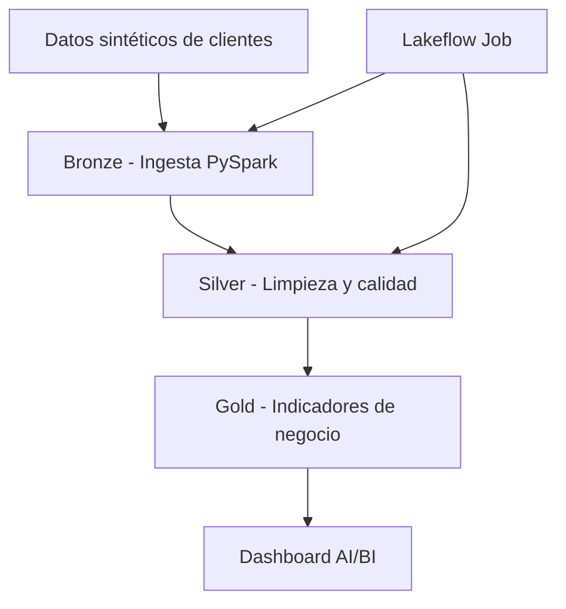

# Telecom Customer Intelligence Platform

**Proyecto Final – Ingeniería de Datos con Databricks**

Plataforma de procesamiento y análisis de datos de clientes del sector
telecomunicaciones, desarrollada sobre Databricks mediante una arquitectura
Medallion (Bronze, Silver y Gold).

## 1. Objetivo

Implementar una solución de ingeniería de datos que permita:

- Ingerir información de clientes mediante PySpark.
- Almacenar datos en tablas Delta Lake.
- Limpiar, transformar y validar la calidad de los datos.
- Construir indicadores de negocio.
- Orquestar los procesos mediante Lakeflow Jobs.
- Visualizar resultados en un dashboard AI/BI.
- Versionar los componentes utilizando Git y GitHub.

## 2. Arquitectura



### Capas Medallion

| Capa | Esquema | Descripción |
|------|---------|-------------|
| Bronze | `workspace.telco_bronze` | Datos originales de clientes |
| Silver | `workspace.telco_silver` | Datos depurados y validados |
| Gold | `workspace.telco_gold` | Indicadores agregados para análisis |

## 3. Tecnologías utilizadas

- Databricks Free Edition
- Apache Spark / PySpark
- Spark SQL
- Delta Lake
- Unity Catalog
- Lakeflow Declarative Pipelines
- Lakeflow Jobs
- Databricks AI/BI Dashboards
- Git y GitHub

## 4. Estructura del repositorio

```text
├── dashboard/     # Definición versionada del dashboard AI/BI
├── docs/          # Documentación adicional
├── notebooks/     # Ingesta y validaciones PySpark
├── pipelines/     # Transformaciones Silver y Gold
├── resources/     # Recursos auxiliares
├── src/           # Código de soporte
├── tests/         # Pruebas del proyecto
└── README.md      # Documentación principal
```

## 5. Procesamiento de datos

### Bronze

Notebook:

`notebooks/01_ingesta_bronze_clientes`

Genera e ingiere 1.000 registros sintéticos de clientes en la tabla:

`workspace.telco_bronze.clientes_raw`

### Silver

Archivo:

`pipelines/01_clientes_silver_lakeflow.sql`

Tabla resultante:

`workspace.telco_silver.clientes`

Transformaciones implementadas:

- Estandarización de campos.
- Conversión de tipos de datos.
- Normalización de valores.
- Eliminación de duplicados.
- Validación de identificadores y fechas.

Se implementaron expectativas de calidad para rechazar registros
con identificador de cliente o fecha de alta nulos.

### Gold

Archivo:

`pipelines/02_clientes_gold_lakeflow.sql`

Vistas materializadas:

1. `workspace.telco_gold.kpi_clientes_ciudad_segmento`
2. `workspace.telco_gold.kpi_altas_mensuales`

Estas vistas contienen los indicadores utilizados por el dashboard.

## 6. Orquestación

Se implementó el Job:

`job_telco_medallion`

Su flujo de ejecución es:

1. `ingesta_bronze_clientes`
2. `refresh_telco_medallion`

La segunda tarea depende de la finalización exitosa de la primera.

El Job fue ejecutado y validado correctamente.

## 7. Resultados obtenidos

Se procesaron 1.000 clientes sintéticos.

| Indicador | Resultado |
|-----------|-----------|
| Total de clientes | 1.000 |
| Clientes activos | 924 |
| Clientes inactivos | 76 |
| Porcentaje de clientes activos | 92,4 % |

Validaciones realizadas:

- 1.000 registros en Silver.
- 1.000 identificadores únicos.
- Sin identificadores de cliente nulos.
- Sin fechas de alta nulas.
- Conciliación de totales entre Silver y Gold.

Los valores corresponden al conjunto de datos sintéticos utilizado
durante el desarrollo.

## 8. Dashboard AI/BI

**Nombre:** Telco Customer Intelligence - Dashboard Gold

**Página:** Resumen ejecutivo

Visualizaciones implementadas:

- Total de clientes.
- Clientes activos.
- Clientes inactivos.
- Porcentaje de clientes activos.
- Distribución de clientes por ciudad y segmento.
- Evolución mensual de nuevos clientes.

La definición del dashboard está versionada en el directorio `dashboard/`.

## 9. Ejecución del proyecto

Para reproducir el procesamiento en Databricks:

1. Configurar un Workspace de Databricks con Unity Catalog
   y cómputo Serverless.

2. Crear los esquemas `telco_bronze`, `telco_silver`,
   `telco_gold` y `telco_ml` en el catálogo `workspace`.

3. Ejecutar el notebook de ingesta Bronze.

4. Configurar el pipeline Lakeflow utilizando los archivos
   SQL del directorio `pipelines/`.

5. Ejecutar el pipeline y validar las tablas Silver y Gold.

6. Ejecutar las pruebas de calidad de datos del directorio
   `tests/`.

7. Ejecutar `02_segmentacion_clientes.ipynb` para entrenar
   K-Means y registrar el modelo en MLflow.

8. Configurar la URI del modelo MLflow y el volumen
   `workspace.telco_ml.mlflow_tmp`.

9. Ejecutar `03_prediccion_segmentos.ipynb` para generar
   predicciones y actualizar la tabla Delta.

10. Configurar `job_telco_medallion` con sus cuatro tareas:
    - ingesta_bronze_clientes
    - refresh_telco_medallion
    - validar_calidad_telco
    - prediccion_segmentos

11. Ejecutar el Job completo y verificar que todas las
    tareas finalicen con estado Succeeded.

12. Importar el dashboard `.lvdash.json`, configurar
    el SQL Warehouse y publicar el dashboard.

La publicación, los permisos del dashboard y la configuración del Job
se administran actualmente en Databricks y no están incluidos
en el versionamiento del código.

## 10. Machine Learning y MLflow

### 10.1. Objetivo

Implementar un modelo de aprendizaje no supervisado para segmentar clientes de telecomunicaciones mediante PySpark MLlib, utilizando K-Means y MLflow para el seguimiento de experimentos.

### 10.2. Preparación y entrenamiento

El notebook `notebooks/02_segmentacion_clientes.ipynb` realiza:

- Lectura de clientes desde `workspace.telco_silver.clientes`.
- Preparación de variables de ciudad, segmento y antigüedad.
- Codificación de características categóricas.
- Construcción y escalado del vector de características.
- Entrenamiento de modelos K-Means con K entre 2 y 8.
- Evaluación mediante Silhouette Score.
- Registro de experimentos y métricas en MLflow.

### 10.3. Resultados

| Métrica | Resultado |
|---|---|
| Algoritmo | K-Means |
| Clientes procesados | 1.000 |
| Modelos evaluados | 7 |
| Mejor K | 5 |
| Silhouette Score | 0.7375 |
| Clústeres generados | 5 |
| Clientes por clúster | 200 |

Los clústeres identificados separan principalmente a los clientes según su ciudad y segmento comercial. Se utilizaron datos sintéticos, por lo que los resultados representan una demostración técnica de segmentación y no una predicción de abandono o rentabilidad.

### 10.4. Inferencia con MLflow

El notebook `notebooks/03_prediccion_segmentos.ipynb` recupera el modelo entrenado desde MLflow y ejecuta predicciones sin necesidad de volver a entrenarlo.

Los resultados se almacenan en la tabla Delta:

`workspace.telco_ml.clientes_segmentados`

Se implementó una operación `MERGE` para actualizar los clientes existentes e insertar nuevos registros.

La ejecución fue validada con 1.000 clientes y cinco clústeres. Se comprobó que una segunda ejecución mantuviera el total de registros.

### 10.5. Automatización con Lakeflow Jobs

El Job `job_telco_medallion` integra cuatro tareas:

| Orden | Tarea | Descripción |
|---|---|---|
| 1 | ingesta_bronze_clientes | Ingesta de clientes |
| 2 | refresh_telco_medallion | Transformación Silver y Gold |
| 3 | validar_calidad_telco | Validaciones de calidad |
| 4 | prediccion_segmentos | Inferencia K-Means y actualización Delta |

Se verificó una ejecución completa de las cuatro tareas con estado `Succeeded`.

### 10.6. Integración con el dashboard

El dashboard **Telco Customer Intelligence - Dashboard Gold** incorpora la distribución de clientes por clúster y segmento, además de los indicadores de negocio existentes.

Indicadores observados:

- Total de clientes: 1.000.
- Clientes activos: 924.
- Clientes inactivos: 76.
- Porcentaje de clientes activos: 92,4 %.
- Clústeres K-Means: 5.

### 10.7. Consideraciones de reproducibilidad

La ejecución requiere un entorno Databricks con acceso a Unity Catalog, Spark, Delta Lake y MLflow.

El modelo se recupera mediante la URI de una ejecución específica de MLflow. Para utilizarlo en otro entorno es necesario disponer del artefacto del modelo y configurar las rutas de los recursos correspondientes.

Los datos de Unity Catalog, los artefactos de MLflow y la configuración operativa de los Jobs no se despliegan automáticamente al clonar este repositorio.

## 11. Próximas mejoras

- Configuración de infraestructura y despliegue como código.
- Parametrización del modelo MLflow y sus dependencias.
- Ampliación del conjunto de datos.
- Automatización CI/CD.
- Monitoreo de calidad y desempeño del modelo.
- Implementación de nuevas variables de comportamiento.

## 12. Autor

**Guillermo Armando Rubio**

Proyecto académico y de portafolio profesional de Ingeniería de Datos.
