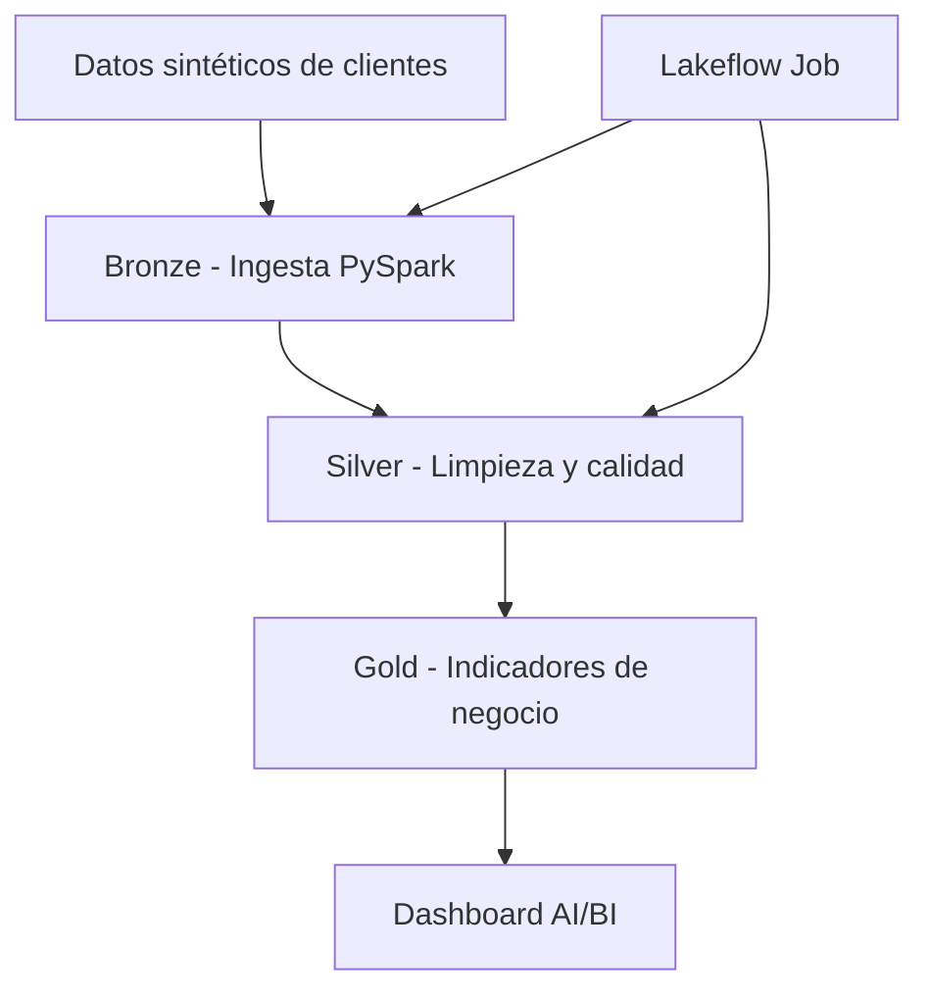

# Telecom Customer Intelligence Platform

**Proyecto Final – Ingeniería de Datos con Databricks**

Plataforma de procesamiento y análisis de datos de clientes del sector
telecomunicaciones, desarrollada sobre Databricks mediante una arquitectura
Medallion (Bronze, Silver y Gold).

## 1. Objetivo

Implementar una solución de ingeniería de datos que permita:

- Ingerir información de clientes mediante PySpark.
- Almacenar datos en tablas Delta Lake.
- Limpiar, transformar y validar la calidad de los datos.
- Construir indicadores de negocio.
- Orquestar los procesos mediante Lakeflow Jobs.
- Visualizar resultados en un dashboard AI/BI.
- Versionar los componentes utilizando Git y GitHub.

## 2. Arquitectura



### Capas Medallion

| Capa | Esquema | Descripción |
|------|---------|-------------|
| Bronze | `workspace.telco_bronze` | Datos originales de clientes |
| Silver | `workspace.telco_silver` | Datos depurados y validados |
| Gold | `workspace.telco_gold` | Indicadores agregados para análisis |

## 3. Tecnologías utilizadas

- Databricks Free Edition
- Apache Spark / PySpark
- Spark SQL
- Delta Lake
- Unity Catalog
- Lakeflow Declarative Pipelines
- Lakeflow Jobs
- Databricks AI/BI Dashboards
- Git y GitHub

## 4. Estructura del repositorio

```text
├── dashboard/     # Definición versionada del dashboard AI/BI
├── docs/          # Documentación adicional
├── notebooks/     # Ingesta y validaciones PySpark
├── pipelines/     # Transformaciones Silver y Gold
├── resources/     # Recursos auxiliares
├── src/           # Código de soporte
├── tests/         # Pruebas del proyecto
└── README.md      # Documentación principal
```

## 5. Procesamiento de datos

### Bronze

Notebook:

`notebooks/01_ingesta_bronze_clientes`

Genera e ingiere 1.000 registros sintéticos de clientes en la tabla:

`workspace.telco_bronze.clientes_raw`

### Silver

Archivo:

`pipelines/01_clientes_silver_lakeflow.sql`

Tabla resultante:

`workspace.telco_silver.clientes`

Transformaciones implementadas:

- Estandarización de campos.
- Conversión de tipos de datos.
- Normalización de valores.
- Eliminación de duplicados.
- Validación de identificadores y fechas.

Se implementaron expectativas de calidad para rechazar registros
con identificador de cliente o fecha de alta nulos.

### Gold

Archivo:

`pipelines/02_clientes_gold_lakeflow.sql`

Vistas materializadas:

1. `workspace.telco_gold.kpi_clientes_ciudad_segmento`
2. `workspace.telco_gold.kpi_altas_mensuales`

Estas vistas contienen los indicadores utilizados por el dashboard.

## 6. Orquestación

Se implementó el Job:

`job_telco_medallion`

Su flujo de ejecución es:

1. `ingesta_bronze_clientes`
2. `refresh_telco_medallion`

La segunda tarea depende de la finalización exitosa de la primera.

El Job fue ejecutado y validado correctamente.

## 7. Resultados obtenidos

Se procesaron 1.000 clientes sintéticos.

| Indicador | Resultado |
|-----------|-----------|
| Total de clientes | 1.000 |
| Clientes activos | 924 |
| Clientes inactivos | 76 |
| Porcentaje de clientes activos | 92,4 % |

Validaciones realizadas:

- 1.000 registros en Silver.
- 1.000 identificadores únicos.
- Sin identificadores de cliente nulos.
- Sin fechas de alta nulas.
- Conciliación de totales entre Silver y Gold.

Los valores corresponden al conjunto de datos sintéticos utilizado
durante el desarrollo.

## 8. Dashboard AI/BI

**Nombre:** Telco Customer Intelligence - Dashboard Gold

**Página:** Resumen ejecutivo

Visualizaciones implementadas:

- Total de clientes.
- Clientes activos.
- Clientes inactivos.
- Porcentaje de clientes activos.
- Distribución de clientes por ciudad y segmento.
- Evolución mensual de nuevos clientes.

La definición del dashboard está versionada en el directorio `dashboard/`.

## 9. Ejecución del proyecto

Para reproducir el procesamiento en Databricks:

1. Configurar un Workspace con Unity Catalog y cómputo Serverless.
2. Crear los esquemas `telco_bronze`, `telco_silver` y `telco_gold`
   dentro del catálogo `workspace`.
3. Ejecutar el notebook de ingesta Bronze.
4. Configurar el pipeline Lakeflow usando los archivos SQL
   del directorio `pipelines/`.
5. Ejecutar el pipeline y verificar las vistas Gold.
6. Configurar el Job con las tareas Bronze y Lakeflow.
7. Importar el archivo `.lvdash.json` y configurar su publicación.

La publicación, los permisos del dashboard y la configuración del Job
se administran actualmente en Databricks y no están incluidos
en el versionamiento del código.

## 10. Próximas mejoras

- Pruebas automatizadas de calidad de datos.
- Configuración de despliegue como código.
- Ampliación del conjunto de datos.
- Modelos de Machine Learning y seguimiento mediante MLflow.
- Automatización CI/CD.

## Autor

**Guillermo Armando Rubio**

Proyecto académico y de portafolio profesional de Ingeniería de Datos.